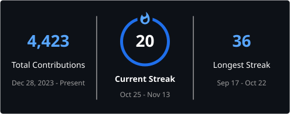

# FarmaanFJM

Software engineer building things around chess, AI, and interactive applications.

### Projects & goals

- **[Summa](https://github.com/FarmaanFJM/summa)** `(private)` : An autonomous AI development workspace that executes, tests, and verifies software.
- **[CaissaTrainer](https://github.com/FarmaanFJM/CaissaTrainer)** `(private)` : A complete chess training platform.
- **[Chess Player Integrity](https://github.com/FarmaanFJM/chess-player-integrity)** `(private)` : Understand player behavior and detect unusual patterns.
- **[ChessOTB](https://github.com/FarmaanFJM/ChessOTB)** `(private)` : Photorealistic 3D chess with online play.
- **[Markdown Studio](https://github.com/FarmaanFJM/markdown-studio)** `(public)` : A modern Markdown editor with live preview and PDF export.
- **[Summa-UI](https://github.com/FarmaanFJM/summa-ui)** `(public)` : A minimal, consistent design system for applications.
- **[manim-chess](https://github.com/FarmaanFJM/manim-chess)** `(private)` : Create beautiful, programmable chess animations.
- **[GitManager](https://github.com/FarmaanFJM/GitManager)** `(public)` : Simplify Git repository management and development workflows.
- **[Tiki Taka](https://github.com/FarmaanFJM/Tiki-Taka)** `(private)` : A physics-driven multiplayer football game.
- **[Mini-Summa](https://github.com/FarmaanFJM/mini-summa)** `(public)` : A lightweight workspace connecting AI coding assistants.
- **[Chess Zen Mode](https://github.com/FarmaanFJM/chess-zen-mode)** `(public)` : A distraction-free chess experience.
  
### GitHub activity

  
  

